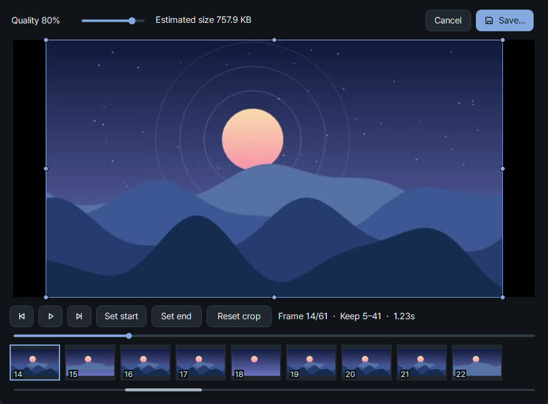

# B01 Recorder

A compact Windows screen recorder for **MP4, GIF, and WebP**. Record a screen, a window, or a region. Trim and crop animations before saving.

[Download the latest Windows release](https://github.com/BE0X01/b01-recorder/releases/latest)

## Preview

| Recorder | GIF and WebP editor |
| --- | --- |
|  |  |

## Install

1. Download `b01-recorder-v1.0-win-x64.zip` from [Releases](https://github.com/BE0X01/b01-recorder/releases/latest) and extract it to a folder you can write to.
2. Run `Install-FFmpeg.cmd` once if FFmpeg is unavailable. It downloads a pinned FFmpeg build from [Gyan.dev](https://www.gyan.dev/ffmpeg/builds/) and verifies its SHA-256 before installing it beside the app.
3. Open `b01-recorder.exe`.

The ZIP includes the .NET 10 runtime for x64. See the [.NET 10 support list](https://github.com/dotnet/core/blob/main/release-notes/10.0/supported-os.md#windows) for supported Windows versions. An existing FFmpeg installation on your PATH also works if it supports Windows screen capture and the required encoders.

## Record

1. Choose **Full screen**, **Window**, or **Region**. For full-screen capture, select one monitor or all monitors.
2. Choose **MP4**, **GIF**, or **WebP**, set the frame rate, and select a save folder. The frame-rate control accepts 1–120 FPS. Cursor capture is optional, and MP4 can include system audio.
3. Click **Record**. MP4 uses **Stop & save** and writes to the chosen folder. GIF and WebP use **Stop & edit** and open the animation editor.

Keep the selected window visible during window recording. Double-click the save path to open the folder in File Explorer, or right-click it to copy the path.

## Edit a GIF or WebP

- Use the frame slider or the scrollable thumbnail strip to find a frame. **Set start** and **Set end** keep both selected endpoints.
- Use the playback controls to jump to either endpoint or play and pause. The preview repeats the selected range.
- Drag the eight crop handles to resize the crop. Drag inside the box to move it within the frame.
- Adjust quality and check the estimated size. Click **Save…** to choose the filename and location. Saved GIF and WebP animations are set to loop.

Large recordings can take longer to prepare or encode.

## Settings and filenames

Open the gear menu to choose **English** or **한국어**, select the **System**, **Light**, or **Dark** theme, or dim the desktop while selecting a region. The app saves preferences to `setting.ini` beside the executable when it exits.

The default filename pattern is `record_%y%m%d-%n`. For example, the first recording on November 18, 2026 might be named `record_261118-01.mp4`. The app adds the extension, uses the recording start time for date and time tags, and picks an available number for `%n`. Open the information button next to the pattern for the full tag list.

## Build from source

Install the [.NET 10 SDK](https://dotnet.microsoft.com/download/dotnet/10.0). Then run the following PowerShell command from the repository root.

```powershell
.\scripts\build.ps1
```

The script publishes a self-contained Windows x64 build and writes the ZIP and SHA-256 checksum to `artifacts/`.

## License

B01 Recorder is licensed under the [MIT License](LICENSE). See [Third-party notices](THIRD-PARTY-NOTICES.md) for the bundled fonts, icons, libraries, and runtime.
